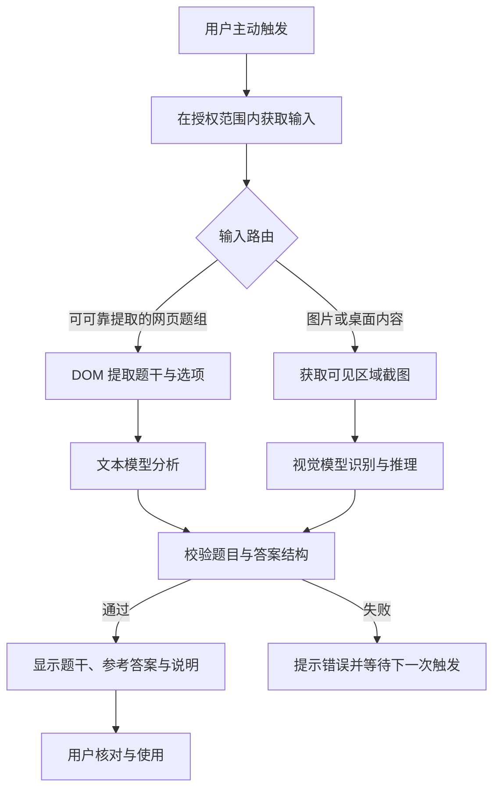

# AutoQuestion

**从屏幕或网页中获取题目，交给模型分析，再以结构化结果辅助核对。**

本仓库分享 AutoQuestion 的基本原理、技术路线和设计取舍，供学习与技术交流。公开内容以说明文档为主，不提供完整可运行源码、安装包或构建教程。

## 基本思路

题目理解可以拆成六步：用户触发、输入获取、路线选择、模型分析、结构校验、结果呈现。

Windows 端以 F8 作为手动触发入口；Android 端通过悬浮窗触发，使用 MediaProjection 获取用户授权的屏幕内容。浏览器 DOM 路线依赖用户授予页面访问权限，截图路线受操作系统的捕获权限与页面保护机制约束。

## 三条技术路线

| 路线 | 在本项目中的定位 | 主要取舍 |
| --- | --- | --- |
| DOM + 文本模型 | 当前设计：从可访问的网页语义结构获取题目 | 文本与选项关系较明确，但依赖页面结构和授权 |
| 截图 + 视觉模型 | 当前设计：直接分析图片；Android 使用此路线 | 适用于桌面窗口、图片与画布，但受画面质量和模型图片能力影响 |
| OCR + 文本模型 | 可选技术路线；当前没有独立 OCR 实现 | 可拆分文字识别与推理，但需额外处理版面、公式和识别误差 |

当前截图路线由视觉模型直接理解图片，不经过单独的 OCR 模块。路线的适用条件、回退原则与校验方式见 [技术路线说明](docs/TECHNICAL_ROUTES.md)。

## 设计中关注的问题

- **取对内容。** 锁定用户触发时的目标；目标变化时停止处理，避免捕获其他窗口或页面。
- **选对路线。** 能可靠获取网页题组时使用 DOM；获取失败后，只有具备截图条件和视觉模型能力时才考虑回退。
- **检查输出。** 统一题型、题干、选项、参考答案和说明的结构，检查缺失字段与答案对应关系。
- **保留人工判断。** 结果用于展示与复制，由用户核对；不自动勾选、填写、提交或翻页。

## 适用边界

适合自建题库、非计分练习和获得授权的学习场景。模型可能漏题、误读或推理错误；结构校验只能检查格式与部分一致性，不能证明答案正确。

DOM 无法可靠覆盖所有网站；截图无法绕过系统禁止捕获的内容。图片模糊、题目不完整、复杂版面与公式都会增加误差。使用远程模型时，题目文本或截图会发送给所选服务，应先确认其中没有无关的私人信息。

本仓库不作准确率、全站兼容或所有模型可用的承诺。欢迎围绕原理、路线取舍与使用边界交流。
